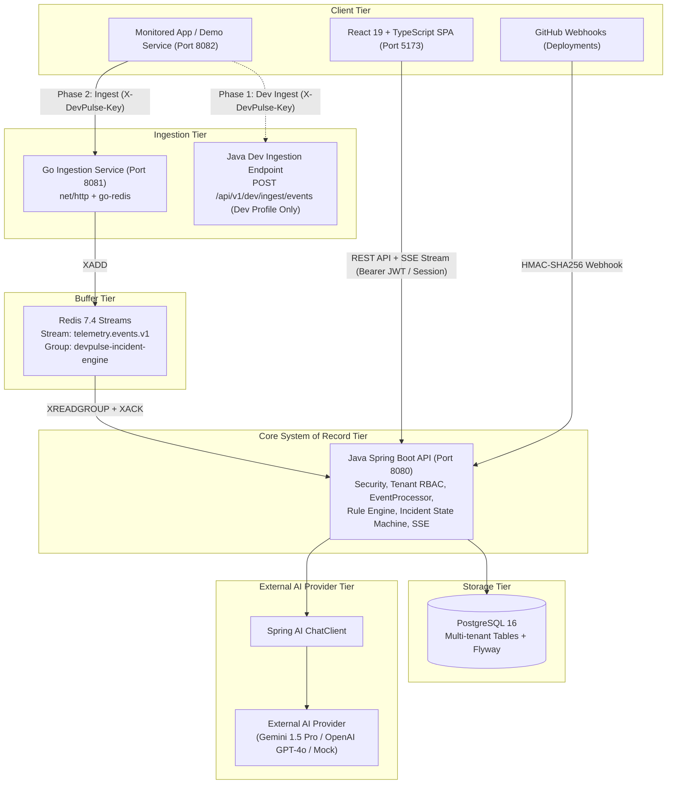
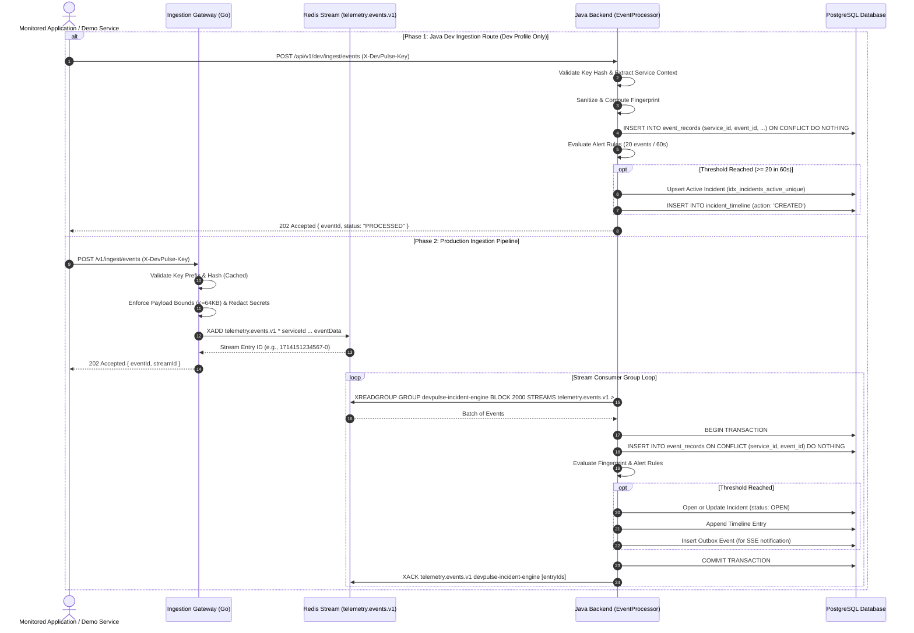
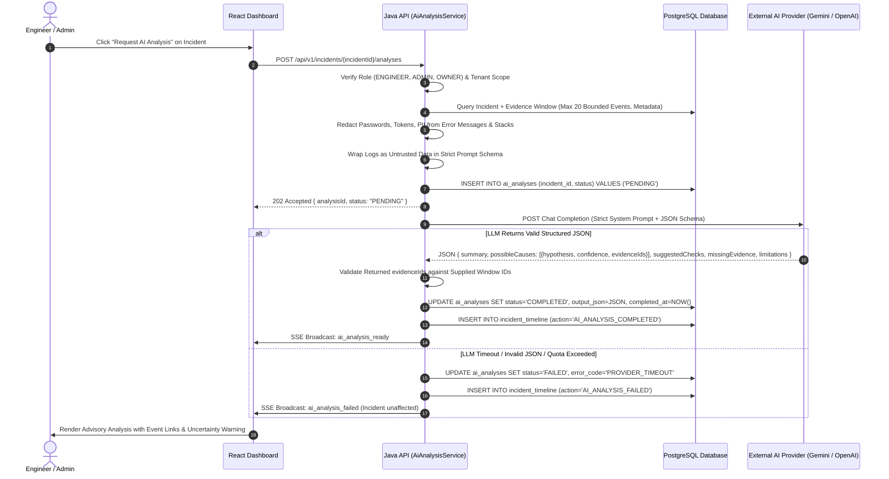
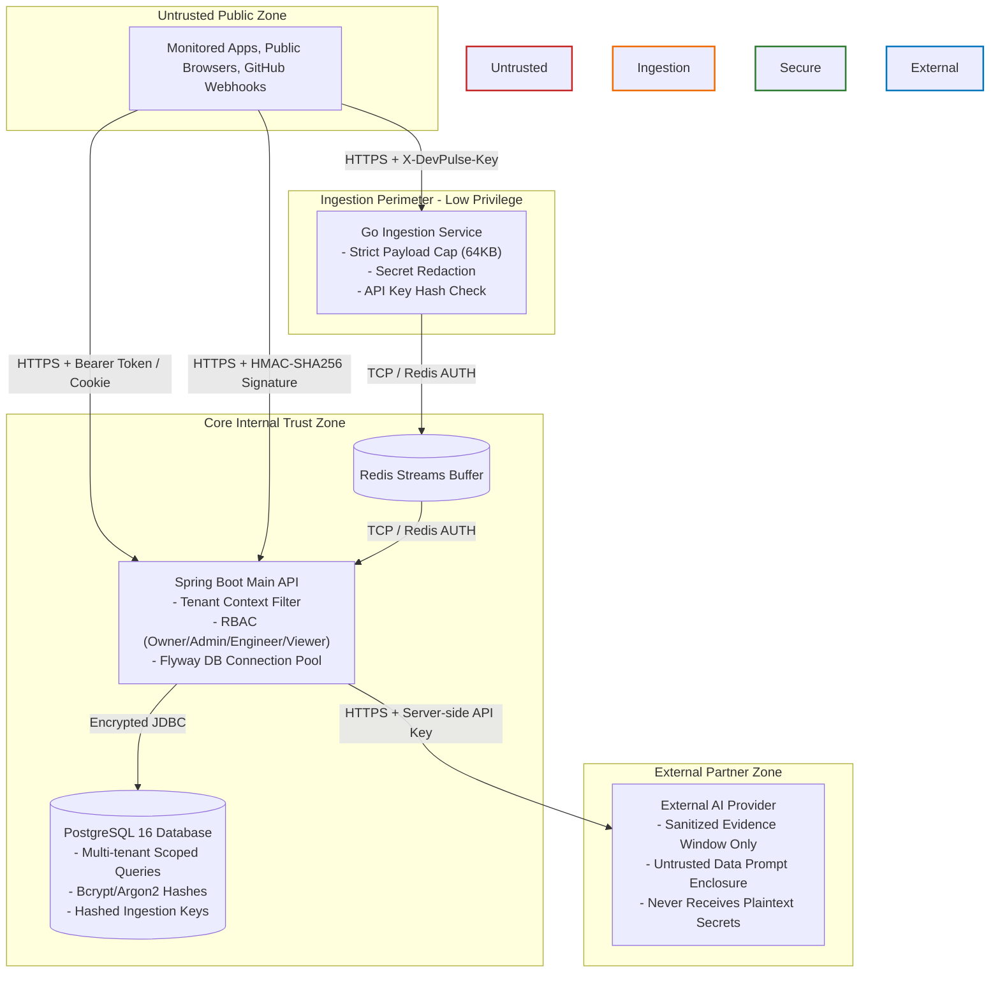

# ADR-001: DevPulse AI Architectural Foundation and Technology Stack

- **Status:** Accepted
- **Date:** 2026-10-26
- **Authors:** Senior Full-Stack Architect & Engineering Team
- **Context:** DevPulse AI Software Requirements Specification (SRS) v1.0 (Sections 1–15)
- **Scope:** Architecture decisions, module boundaries, technology selection, dependency compatibility, data contracts, security boundaries, and local environment setup.

---

## 1. Context and Problem Statement

When an application fails, operational evidence is scattered across logs, services, deployments, and notification channels. Teams experience alert fatigue, duplicate incidents, disjointed deployment correlation, and slow mean time to resolution (MTTR).

**DevPulse AI** is an AI-assisted application monitoring and incident management platform designed to:
1. Ingest telemetry events reliably with low latency and bounded resource consumption.
2. Deduplicate and normalize errors into deterministic fingerprints.
3. Group repeating error bursts into actionable, state-managed incidents (default demonstration rule: 20 matching occurrences in a rolling 60-second window).
4. Correlate incidents with recent operational changes (such as GitHub deployments) without asserting unverified causality.
5. Assist engineers during triage with external Large Language Model (LLM) advisory analysis, without training custom models, without leaking sensitive secrets, and without permitting automated unsafe actions.

A clear, stable architecture with strict multi-tenant boundaries, immutable audit logs, and phased delivery (Java-first MVP -> Go/Redis ingestion pipeline -> AI advisory integration -> hardening) is required before implementing application logic.

---

## 2. Decision Summary & Technology Compatibility Matrix

### 2.1 Core Technology Choices

| Layer / Component | Chosen Technology | Version Baseline | Rationale & Compatibility Reference |
| :--- | :--- | :--- | :--- |
| **Main API & Business Logic** | Java + Spring Boot | Java 21 (LTS target) / Spring Boot 3.4.1 | Java 21 provides LTS stability, Virtual Threads (`Loom`), and strict pattern matching. Spring Boot 3.4.1 offers production-grade Actuator, Flyway 10.x integration, Spring Data JPA, and official Spring AI compatibility. Compiles cleanly on local JDK 25 with `--release 21`. |
| **AI Integration** | Spring AI | 1.0.0-M5 (Milestone) | Native Spring Boot integration for LLM abstractions (`ChatModel`, `ChatClient`), structured output parsing (`BeanOutputConverter`), and clean mock/fake test providers. Connects to OpenAI or Google Gemini API. |
| **Telemetry Ingestion Gateway** | Go | Go 1.23.x / 1.24.x | Minimal footprint, standard library `net/http` with enhanced URL routing (Go 1.22+ pattern matching), high-concurrency goroutines, and non-blocking I/O. Decoupled from JVM garbage collection pauses for incoming ingestion spikes. |
| **Ingestion Message Broker** | Redis Streams | Redis 7.4-alpine | In-memory message persistence with consumer groups (`XADD`, `XREADGROUP`, `XACK`, `XPENDING`, `XCLAIM`). Provides backpressure buffer between Go collector and Java incident engine. Stream: `telemetry.events.v1`. |
| **Primary System of Record** | PostgreSQL | PostgreSQL 16.4-alpine | ACID transactions, native JSONB support for unstructured event attributes and AI responses, `pgcrypto` / native UUIDv4, and partial unique indexes for race-safe incident creation. |
| **Database Migrations** | Flyway | Flyway 10.20.x | Deterministic, forward-only SQL migrations (`V1__...`, `V2__...`) tracked in version control. Eliminates JPA auto-DDL in all environments. |
| **Web Frontend** | React + TypeScript + Vite | React 18.3 / 19.0, TS 5.6+, Vite 6.0 | Fast HMR, strong static typing, native ESM, and compact production bundle. |
| **Frontend State & UI** | TanStack Query v5 + Vanilla CSS | TanStack Query v5.62+, Custom CSS Design Tokens | Server-state caching, automatic refetching, and background polling. Vanilla CSS with custom properties ensures ultra-responsive, zero-runtime-overhead glassmorphic dark-mode styling without brittle utility dependencies. |
| **Container Orchestration** | Docker Compose | Compose Specification v2.29+ / v5.x | Declarative local orchestration with health checks, network isolation, and named persistent volumes for PostgreSQL and Redis. |

### 2.2 Dependency Compatibility Verification

- **Spring Boot 3.4.1 + Java 21 LTS:** Officially supported by VMware Tanzu. Local host running JDK 25 uses `maven-compiler-plugin` configured with `<release>21</release>`, guaranteeing byte-code execution compatibility with containerized `eclipse-temurin:21-jre-alpine`.
- **Spring AI 1.0.0-M5 + Spring Boot 3.4.x:** Available via Spring Milestone repository (`repo.spring.io/milestone`). Compatible with Spring Framework 6.2 and Jakarta EE 10.
- **Flyway 10.x + PostgreSQL 16:** Flyway `flyway-database-postgresql` module fully supports PostgreSQL 16 JSONB operators and partial index DDL.
- **Redis 7.4 + go-redis/v9 (v9.7.0):** Supports Redis Streams consumer groups, pending entries list (PEL), and stream trimming (`MAXLEN ~ 100000`).

---

## 3. Module Boundaries & Service Responsibilities

The system is organized as a unified monorepo with strict separation of concerns:

```
devpulse-ai/
├── backend-java/         # Main Spring Boot API (System of record, rules, incident engine, AI)
├── ingestion-go/         # Go net/http high-throughput telemetry collector (Phase 2)
├── frontend/             # React + TypeScript + Vite web application
├── demo-application/     # Synthetic workload and error-burst simulator
├── infrastructure/       # Docker Compose, environment definitions, seed scripts
└── docs/                 # ADRs, SRS v1.0, specifications, sequence diagrams, runbooks
```

### 3.1 Responsibilities Breakdown



1. **`ingestion-go` (Public Ingestion Gateway - P1):**
   - High-concurrency HTTP endpoint: `POST /v1/ingest/events`.
   - Validates `X-DevPulse-Key` prefix and SHA-256 hash against in-memory/Redis cached key metadata.
   - Enforces payload bounds (max 64 KB total body; max 2 KB error message).
   - Sanitizes and redacts well-known credential patterns (passwords, JWTs, API tokens, AWS keys).
   - Writes event to Redis Stream `telemetry.events.v1` via `XADD`.
   - Returns `202 Accepted` only after confirmed Redis write.
   - Never accesses PostgreSQL directly.

2. **`backend-java` (Core System of Record & Engine - P0 & P1):**
   - **Tenant & Identity Management:** Organizations, users, memberships (`OWNER`, `ADMIN`, `ENGINEER`, `VIEWER`), projects, environments, and services.
   - **Ingestion Key Management:** Key generation (`dp_live_...`), SHA-256 hashing, prefix storage, key revocation, and rotation. Raw key revealed only once.
   - **Phase 1 Dev Route:** `POST /api/v1/dev/ingest/events` enables complete vertical slice validation before Go collector and Redis are booted.
   - **Shared `EventProcessor`:** Common component shared by Dev route and Redis Streams consumer. Implements idempotent insert into `event_records` using unique constraint `(service_id, event_id)`.
   - **Deterministic Fingerprinting & Alert Rule Engine:** Computes normalized SHA-256 fingerprint; checks rolling 60-second window against configured alert rules (e.g., 20 events in 60s).
   - **Incident State Machine:** Manages lifecycle transitions (`OPEN` -> `ACKNOWLEDGED` -> `INVESTIGATING` -> `RESOLVED` / `REOPENED`) with atomic concurrency guards, audit timeline logging, and role verification.
   - **Real-Time Notification Hub:** Authenticated Server-Sent Events (SSE) `/api/v1/organizations/{orgId}/stream` for live UI updates.
   - **AI Advisory Service:** Orchestrates Spring AI, redacts sensitive evidence, constructs strict JSON prompt schema, validates returned evidence references, and persists advisory results.
   - **GitHub Deployment Receiver:** Verifies raw payload HMAC-SHA256 signatures, correlates deployments with incidents on the timeline.

3. **`frontend` (React + TypeScript):**
   - User authentication, organization switching, and role-aware navigation.
   - Project and service registration; one-time ingestion key generation modal with secure copy warning.
   - Real-time incident dashboard with active count badges, severity badges, and SSE live refresh.
   - Telemetry event explorer with filterable level, service, environment, and error type.
   - Incident triage workspace: timeline view, event evidence inspection, assignment controls, and resolution workflows.
   - AI Advisory drawer: displays root-cause hypotheses linked to verified event IDs, explicit uncertainty indicators, and postmortem draft review.

---

## 4. Logical Sequence Diagrams

### 4.1 Telemetry Event Ingestion Pipeline (Phase 1 & Phase 2)



### 4.2 AI Incident Advisory Analysis Flow



---

## 5. Security & Trust Boundaries



---

## 6. Monorepo Directory Structure

```
devpulse-ai/
├── .editorconfig
├── .gitignore
├── .env.example
├── README.md
├── DevPulse_AI_Build_Prompts.md
├── docs/
│   ├── DevPulse_AI_SRS_v1.0.md            # Extracted official SRS v1.0
│   ├── adr/
│   │   └── ADR-001-architecture-foundation.md
│   ├── spec/
│   │   └── system-contracts.md
│   └── environment-setup.md
├── infrastructure/
│   ├── docker-compose.yml
│   └── postgres/
│       └── init-extensions.sql
├── backend-java/
│   ├── pom.xml
│   ├── mvnw
│   ├── mvnw.cmd
│   └── src/
│       ├── main/
│       │   ├── java/com/devpulse/
│       │   │   ├── DevPulseApplication.java
│       │   │   ├── common/         # REST Error, Tenancy, Base Entities
│       │   │   ├── auth/           # Spring Security, JWT/Session, Users
│       │   │   ├── tenant/         # Organizations, Memberships, Projects, Services
│       │   │   ├── ingestion/      # Dev Route, Keys, EventProcessor
│       │   │   ├── rules/          # Alert Rules, Fingerprinting, Sliding Window
│       │   │   ├── incidents/      # Incident State Machine, Timeline, SSE
│       │   │   ├── ai/             # Spring AI Client, Prompts, DTOs
│       │   │   └── deployments/    # GitHub Webhooks, Postmortems
│       │   └── resources/
│       │       ├── application.yml
│       │       ├── application-dev.yml
│       │       ├── application-prod.yml
│       │       └── db/migration/   # Flyway V1__... SQL migrations
│       └── test/
│           └── java/com/devpulse/
├── ingestion-go/
│   ├── go.mod
│   ├── go.sum
│   ├── cmd/server/main.go
│   └── internal/
│       ├── config/
│       ├── handler/
│       ├── sanitizer/
│       └── stream/
├── frontend/
│   ├── package.json
│   ├── vite.config.ts
│   ├── tsconfig.json
│   ├── index.html
│   └── src/
│       ├── main.tsx
│       ├── App.tsx
│       ├── index.css
│       ├── api/            # Typed fetch client & endpoints
│       ├── components/     # Reusable UI components
│       ├── context/        # Auth and Tenant context
│       ├── hooks/          # React Query & SSE hooks
│       └── pages/          # Dashboard, Incidents, Services, Explorer
└── demo-application/
    ├── pom.xml
    └── src/main/java/com/devpulse/demo/
```
