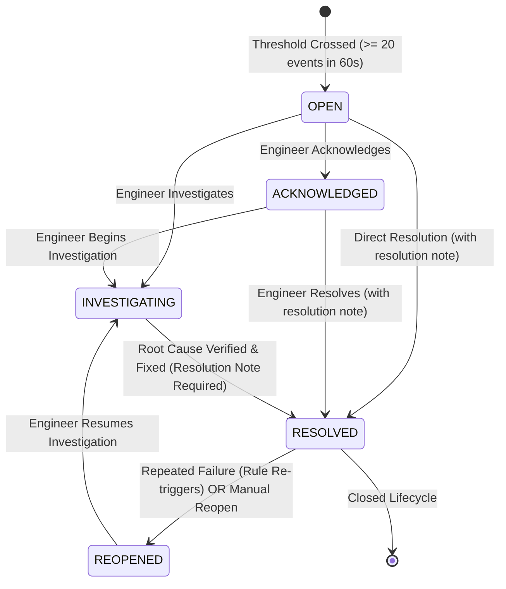
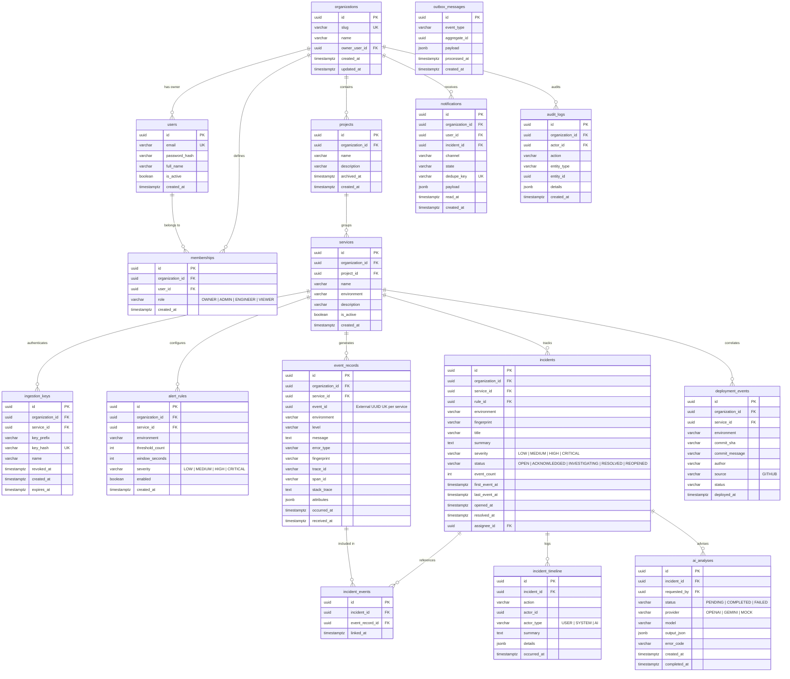

# DevPulse AI — System Contracts, Data Specifications, and Algorithms

- **Document Version:** 1.0.0
- **SRS Alignment:** DevPulse AI SRS v1.0 (Sections 1–15)
- **Companion:** [ADR-001](file:///s:/Personal%20Project/DevPulse/docs/adr/ADR-001-architecture-foundation.md), [SRS v1.0](file:///s:/Personal%20Project/DevPulse/docs/DevPulse_AI_SRS_v1.0.md)
- **Scope:** API contracts, error payloads, timestamp standards, fingerprinting algorithm, incident state transitions, database schema ERD, and priority taxonomy.

---

## 1. REST API Standards & Error Contract (SRS Section 8)

### 1.1 Timestamp Format
All timestamps across all APIs, database columns, log messages, and stream payloads **must** adhere strictly to:
- **Standard:** ISO-8601 Extended Format in UTC with millisecond precision and literal `Z` timezone indicator.
- **Pattern:** `YYYY-MM-DD'T'HH:mm:ss.SSS'Z'`
- **Example:** `2026-10-26T17:36:20.123Z`
- **Rule:** Never serialize timestamps in local time or epoch integers in public API responses.

### 1.2 Standard REST Error Response (RFC 7807 / RFC 9457)
All error responses from the Java Main API and the Go Ingestion Gateway return a standardized JSON structure with `Content-Type: application/problem+json`:

```json
{
  "type": "https://devpulse.ai/errors/INVALID_PAYLOAD",
  "title": "Bad Request",
  "status": 400,
  "detail": "Field 'occurredAt' must be a valid UTC ISO-8601 timestamp.",
  "instance": "/api/v1/dev/ingest/events",
  "code": "INVALID_FIELD_FORMAT",
  "timestamp": "2026-10-26T17:36:20.123Z",
  "correlationId": "req-9b1deb4d-3b7d-4bad-9bdd-2b0d7b3dcb6d",
  "validationErrors": [
    {
      "field": "occurredAt",
      "rejectedValue": "2026-10-26 17:36:20",
      "message": "Must match ISO-8601 UTC format (e.g., 2026-10-26T17:36:20.123Z)"
    }
  ]
}
```

#### Error Response Field Reference

| Field | Type | Description |
| :--- | :--- | :--- |
| `type` | URI String | Permanent reference URI identifying the problem classification. |
| `title` | String | Short, human-readable summary of the HTTP status. |
| `status` | Integer | The exact HTTP status code (e.g., 400, 401, 403, 404, 409, 413, 429, 500, 503). |
| `detail` | String | Clear explanation specific to this occurrence of the problem. No leaked stack traces. |
| `instance` | String | Relative URI of the requested endpoint. |
| `code` | String | Domain-specific machine-readable error token (e.g., `SERVICE_NOT_FOUND`, `DUPLICATE_RESOURCE`). |
| `timestamp` | String | UTC ISO-8601 timestamp when the error occurred. |
| `correlationId` | String | Request tracing ID (propagated from `X-Correlation-ID` header or generated UUID). |
| `validationErrors` | Array | Optional list of field-level validation errors (populated on 400/422). |

---

## 2. Ingestion Event Contract (SRS Section 7.2)

Both `POST /api/v1/dev/ingest/events` (Java Dev Route) and `POST /v1/ingest/events` (Go Collector) consume the following event JSON structure:

### 2.1 Request Headers
- `Content-Type`: `application/json`
- `X-DevPulse-Key`: `dp_live_a1b2c3d4e5f6...` (Service Ingestion Key)
- `X-Correlation-ID`: *(Optional)* UUID for end-to-end tracing

### 2.2 Ingestion Payload Schema

```json
{
  "eventId": "e9b68ea1-44a0-4f9b-a060-5c98aa1a7be2",
  "occurredAt": "2026-10-26T10:30:00Z",
  "level": "ERROR",
  "message": "Database connection timeout",
  "errorType": "DATABASE_TIMEOUT",
  "traceId": "trace-abc123",
  "spanId": "00f067aa0ba902b7",
  "stackTrace": "java.sql.SQLTimeoutException: Timeout...\n\tat com.devpulse.demo.OrderService.checkout(OrderService.java:42)",
  "attributes": {
    "endpoint": "POST /checkout",
    "httpStatus": 500
  }
}
```

### 2.3 Payload Bounds & Security Rules
- **Identity Derivation:** Clients do **NOT** choose `organizationId` or `serviceId` in the ingestion payload; the receiving service derives trusted identity strictly from the validated `X-DevPulse-Key`.
- `eventId`: Required, valid UUID v4 format.
- `occurredAt`: Required, valid UTC ISO-8601 string. Bounded tolerance: cannot be more than 15 minutes in future or 24 hours in past.
- `level`: Required enum: `INFO`, `WARN`, `ERROR`, `FATAL`. Only `ERROR` and `FATAL` trigger alert rule evaluations.
- `message`: Required, min 1 char, max 2048 chars (truncated if exceeded).
- `errorType`: Required, min 1 char, max 255 chars (e.g. `DATABASE_TIMEOUT`).
- `traceId`: Optional, max 64 chars.
- `stackTrace`: Optional, max 8192 chars.
- `attributes`: Optional JSON object, max 32 key-value pairs, nested depth <= 2, total size <= 8 KB.
- Total HTTP Request Body Size: Hard limit 64 KB.

---

## 3. Deterministic Event Fingerprinting Algorithm (SRS Section 6.2)

To group recurring errors without creating duplicate incidents, DevPulse computes a deterministic 64-character SHA-256 fingerprint for every ingested event.

### 3.1 Normalization Pipeline

Variable runtime data (dynamic UUIDs, hex memory pointers, timestamps, IP addresses, numeric IDs) must be stripped before hashing:

```
Raw Error Message:
"Failed to acquire lease for customer 9a7812e4-44b2-4d1a-9694-87cc9921cb91 at host 10.0.4.15:8080 (pointer 0x7fff5fbff8a0) after 3000ms"
                                ↓
1. Replace UUIDs:
   Regex: [0-9a-fA-F]{8}-[0-9a-fA-F]{4}-[0-9a-fA-F]{4}-[0-9a-fA-F]{4}-[0-9a-fA-F]{12}
   Replacement: "<UUID>"
                                ↓
2. Replace IPv4/IPv6 Addresses:
   Regex: \b(?:\d{1,3}\.){3}\d{1,3}(?::\d+)?\b
   Replacement: "<IP>"
                                ↓
3. Replace Hex Memory Addresses / Pointers:
   Regex: 0x[0-9a-fA-F]+
   Replacement: "<HEX>"
                                ↓
4. Replace Standalone Numeric Identifiers & Durations:
   Regex: \b\d+\b
   Replacement: "<NUM>"
                                ↓
5. Collapse Consecutive Whitespace:
   Regex: \s+
   Replacement: " "
                                ↓
Normalized Template:
"Failed to acquire lease for customer <UUID> at host <IP> (pointer <HEX>) after <NUM>ms"
```

### 3.2 Fingerprint Hash Calculation

The fingerprint string combines tenant context and normalized error attributes:

```
FingerprintInput = Concatenate(
    organization_id, ":",
    project_id, ":",
    service_id, ":",
    environment, ":",
    error_type.trim().toLowerCase(), ":",
    normalized_template.trim().toLowerCase()
)

Fingerprint = HexEncode(SHA-256(FingerprintInput.getBytes(StandardCharsets.UTF_8)))
```

**Output:** 64-character lowercase hexadecimal hash.

---

## 4. Alert Rule Engine: "20 Events in 60 Seconds" Rule (SRS Section 6.2)

### 4.1 Default Demonstration Rule
- **Scope:** Scoped to `service_id` and `environment`.
- **Threshold:** `threshold_count = 20`.
- **Window:** `window_seconds = 60` (Rolling Sliding Window).
- **Matching Criterion:** Events sharing the identical computed `fingerprint`.

### 4.2 Sliding Window Algorithm
When a qualifying event (`level IN ('ERROR', 'FATAL')`) is ingested at time `T = occurredAt`:

1. Calculate window start time: `windowStart = T - 60 seconds`.
2. Query event count using PostgreSQL index `(service_id, fingerprint, occurred_at)`:
   ```sql
   SELECT COUNT(*)
   FROM event_records
   WHERE service_id = :serviceId
     AND fingerprint = :fingerprint
     AND occurred_at >= :windowStart
     AND occurred_at <= :T;
   ```
3. If `event_count < 20`: Event is recorded; no incident is opened.
4. If `event_count >= 20`: Evaluate Incident State Machine.

---

## 5. Incident State Machine & Concurrency Control (SRS Section 6.1)

### 5.1 Status Lifecycle



### 5.2 Transition Guard Rules

| From State | To State | Permitted Roles | Preconditions & Side Effects |
| :--- | :--- | :--- | :--- |
| `*` | `OPEN` | `SYSTEM` (Engine) | Triggered when rule threshold is met. Opens new incident if no active incident exists for `(service_id, environment, fingerprint)`. |
| `OPEN` | `ACKNOWLEDGED` | `ENGINEER`, `ADMIN`, `OWNER` | Halts alerting escalation. Appends entry to `incident_timeline`. |
| `OPEN` / `ACKNOWLEDGED` | `INVESTIGATING` | `ENGINEER`, `ADMIN`, `OWNER` | Marks incident actively under review. Appends to `incident_timeline`. |
| Any Active | `RESOLVED` | `ENGINEER`, `ADMIN`, `OWNER` | Sets `resolved_at = NOW()`. Requires resolution summary note. Releases active partial unique index slot. |
| `RESOLVED` | `REOPENED` | `SYSTEM` or `ENGINEER+` | Triggered if new qualifying events occur after resolution or manually reopened. Transitions directly to `INVESTIGATING`. |

*Note: Role `VIEWER` is strictly read-only and denied on all state transitions (`403 Forbidden`).*

### 5.3 Concurrency & Race-Safe Deduplication

To prevent race conditions where concurrent events open duplicate incidents:
1. **Database Partial Unique Index:**
   ```sql
   CREATE UNIQUE INDEX idx_incidents_active_unique
   ON incidents (service_id, environment, fingerprint)
   WHERE status IN ('OPEN', 'ACKNOWLEDGED', 'INVESTIGATING', 'REOPENED');
   ```
2. **Atomic Incident Upsert:**
   ```sql
   INSERT INTO incidents (
       id, organization_id, service_id, environment, fingerprint,
       title, summary, severity, status, event_count, first_event_at, last_event_at, opened_at
   ) VALUES (
       :id, :orgId, :serviceId, :env, :fingerprint,
       :title, :summary, :severity, 'OPEN', 1, :occurredAt, :occurredAt, NOW()
   )
   ON CONFLICT (service_id, environment, fingerprint)
   WHERE status IN ('OPEN', 'ACKNOWLEDGED', 'INVESTIGATING', 'REOPENED')
   DO UPDATE SET
       event_count = incidents.event_count + 1,
       last_event_at = EXCLUDED.last_event_at,
       updated_at = NOW();
   ```

---

## 6. AI Advisory Contract (SRS Section 9.2)

The external AI model (via Spring AI) returns strictly structured, validated JSON:

```json
{
  "summary": "Checkout requests failed with database timeouts.",
  "possibleCauses": [
    {
      "hypothesis": "Connection pool exhaustion",
      "confidence": "possible",
      "evidenceIds": ["e9b68ea1-44a0-4f9b-a060-5c98aa1a7be2"]
    }
  ],
  "suggestedChecks": [
    "Inspect connection-pool utilization and timeout settings"
  ],
  "missingEvidence": [
    "Pool saturation metrics"
  ],
  "limitations": "No database metric data was provided."
}
```

### 6.1 Validation Rules
- `summary`: Non-blank string summarizing the incident based solely on supplied evidence.
- `possibleCauses`: Array of objects containing `hypothesis`, qualitative `confidence` (`possible`, `likely`, `unlikely`), and `evidenceIds`.
- `evidenceIds`: Every referenced ID must exist within the supplied evidence window. Unsupported IDs are rejected by DTO validation.
- `limitations`: Explicit statement of data missing from analysis.
- **Safety Rule:** Advisory only. No automated production mutation tools or shell actions.

---

## 7. Entity Relationship Diagram (ERD) (SRS Section 7.1)



---

## 8. Priority Taxonomy (SRS Section 2.3)

| Priority | Slice | Scope in DevPulse AI |
| :--- | :--- | :--- |
| **P0** (Java-First Vertical Slice) | MVP Core | Auth (`/register`, `/login`, `/me`), Organization & Membership CRUD (`OWNER`, `ADMIN`, `ENGINEER`, `VIEWER`), Project/Service CRUD, Direct Java Dev Ingestion (`POST /api/v1/dev/ingest/events`), Events Explorer, Alert Rules, Deterministic Fingerprinting, 20-in-60s sliding window detection, Incidents (`OPEN` -> `ACKNOWLEDGED` -> `INVESTIGATING` -> `RESOLVED`), Basic React Dashboard, automated tests. |
| **P1** (Portfolio-Grade) | Production Resilience & AI | Go Ingestion Collector (`POST /v1/ingest/events`), Redis Streams (`telemetry.events.v1`), reliable Java consumer group with commit-before-XACK, SSE real-time streaming (`/api/v1/organizations/{orgId}/stream`), in-app notifications with outbox deduplication, Spring AI incident analysis with prompt injection defense, GitHub deployment HMAC webhooks, and AI-assisted reviewed postmortems. |
| **P2** (Expansion) | Observability Depth | OpenTelemetry trace correlation, Prometheus/Micrometer metrics export, Grafana Loki log query panel, complex policies, rich analytics, and external email alerts. |
